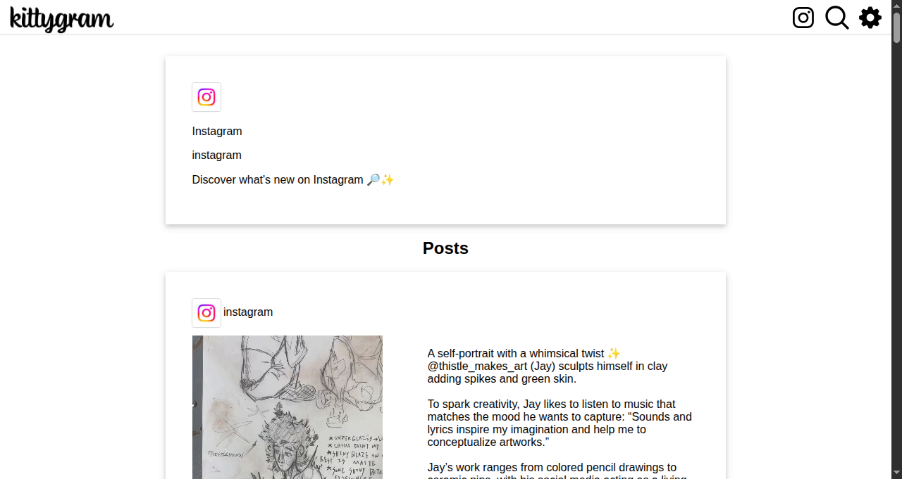

# Kittygram

[](https://www.gnu.org/licenses/agpl-3.0.en.html)

Kittygram is an anonymous, privacy-friendly, lightweight, and open-source
Instagram frontend inspired by [nitter](https://github.com/zedeus/nitter).
It offers a clean, fast way to browse Instagram without the usual clutter or tracking.

## Why

The official Instagram web interface is heavy on JavaScript,
slow to load, and filled with pop-ups.
Kittygram avoids all of that by serving fully prerendered pages,
making it faster and easier to use.

Kittygram also helps you avoid the heavy tracking instagram does,
as all requests are handled by kittygram.

## Limitations

- As of now, only the first ~20 comments on a post can be fetched.
- Instagram aggresively rate-limits requests coming from servers,
which can make running a public instance difficult.

## Screenshot



## Instances

| URL                                | Description                                                                       |
|------------------------------------|-----------------------------------------------------------------------------------|
| <https://kittygr.am>               | An instance of kittygram operated by [FSKY](https://fsky.io).                     |
| <https://kittygram.irelephant.net> | An instance of kittygram run by its creator.                                      |
| <https://kittygram.kareem.one>     | An instance of kittygram operated by [Kareem](https://kareem.one) behind Cloudflare.                |
| <https://kittygram.nexussfan.cz>   | An instance of kittygram operated by [NexusSfan](https://mrchicken.nexussfan.cz). |

## Installation

> [!NOTE]
> I highly recommend you install kittygram using Docker.
Luarocks can be finicky a lot of the time.

### Method 1: Docker

1. Install [docker](https://docs.docker.com/engine/install).
2. Clone and move to Kittygram folder.

```bash
git clone https://codeberg.org/irelephant/kittygram.git
cd kittygram
```

3. Start the container.

```bash
sudo docker compose up
```

### Method 2: Running from scratch

1. Install [openresty](https://openresty.org/en/installation.html).
2. Install [redis](https://redis.io/docs/latest/operate/oss_and_stack/install/archive/install-redis) or [valkey](https://valkey.io/topics/installation).
3. Install [luarocks](https://luarocks.org) (likely in your distro's package manager).
4. Clone and move to Kittygram folder.

```bash
git clone https://codeberg.org/irelephant/kittygram.git
cd kittygram
```

5. Copy the example configuration files:  
```
cp nginx.example.conf nginx.conf
cp config.example.lua config.lua
```

6. Run:

```bash
luarocks init --lua-version=5.1 --lua-versions=5.1
CC="gcc -std=gnu99" luarocks build
```

7. Run `lapis migrate`, then `lapis serve production` to run the project.

## Contact

Feel free to join the [Matrix room](https://matrix.to/#/#kittygram:private.coffee), or email me at [irelephant@disroot.org](mailto:irelephant@disroot.org).

---

Kittygram is licensed under the [AGPL-3.0](https://codeberg.org/irelephant/kittygram/src/branch/main/LICENSE).

Icon made by [nulla](https://codeberg.org/nulla).
